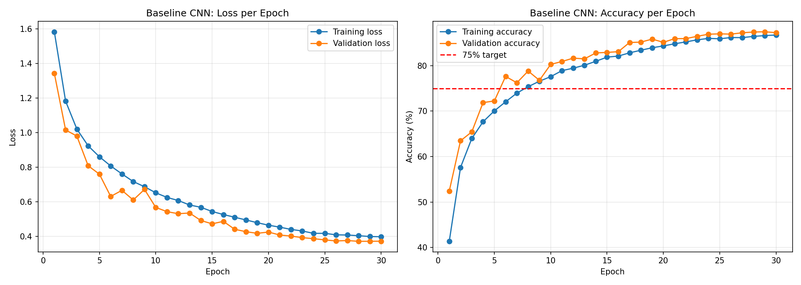
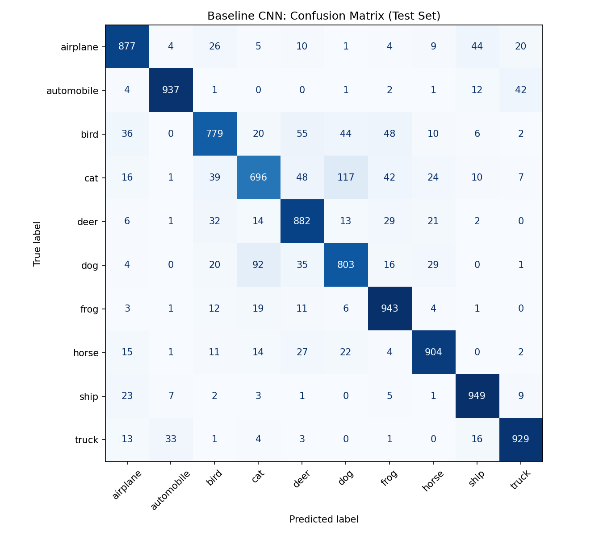
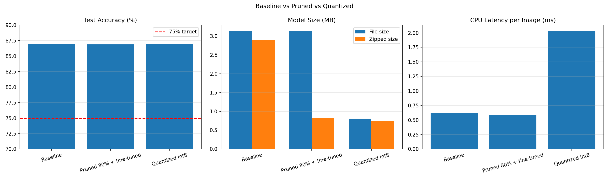

# Assignment 6: Model Compression and Optimization on CIFAR-10

## 1. Introduction

The goal of this assignment was to build a convolutional neural network (CNN) that classifies CIFAR-10 images, and then make it smaller and faster with model compression techniques. CIFAR-10 contains 60,000 colour images of 32 × 32 pixels in 10 balanced classes: airplane, automobile, bird, cat, deer, dog, frog, horse, ship and truck. I used the official split of 50,000 training images and 10,000 test images, and kept 5,000 of the training images aside for validation.

Model compression matters because a model that runs well on a powerful computer may be too large or too slow for a phone or another small device. I applied two techniques to the same baseline model, pruning and quantization, and compared accuracy, model size and inference latency.

**Environment:** Python 3.14, PyTorch 2.11.0 with CUDA 12.8, trained on an NVIDIA GeForce RTX 5060 Laptop GPU. All latency measurements in the comparison were taken on the CPU (Intel Core Ultra 9).

## 2. Baseline Model

**Data preparation.** Training images were randomly shifted (random crop with 4 pixels of padding) and flipped horizontally, which is a form of data augmentation. All images were converted to values between 0 and 1 and standardized with the mean and standard deviation of each colour channel, calculated on the training set.

**Architecture.** The model has three stages. Each stage has two blocks of convolution (3 × 3 filters), batch normalization and ReLU, followed by max pooling and dropout. The number of filters grows from 32 to 64 to 128 while the image size shrinks from 32 × 32 to 4 × 4. A classifier then flattens the 2,048 features and passes them through a fully connected layer of 256 units and a final layer of 10 outputs.

The model has 815,018 parameters. Almost two thirds of them (524,544) are in the first fully connected layer.

**Training.** 30 epochs, batch size 128, AdamW optimizer (learning rate 0.001, weight decay 0.0005), cosine learning rate schedule and cross-entropy loss. Each epoch took about 11 seconds, so training took 5.4 minutes. I kept the weights from the epoch with the best validation accuracy, 87.46%.

Both losses fell steadily and the validation accuracy stayed slightly above the training accuracy. This is expected because augmentation and dropout make training harder, and it shows that the model did not overfit.

**Test results.** 86.99% test accuracy, 3.13 MB file size, 0.62 ms per image on the CPU ([GPU ms] ms on the GPU).

Vehicles were the easiest classes (automobile F1-score 0.944, ship 0.930, truck 0.923). Cat was the hardest (recall 0.696, F1-score 0.746), followed by dog (0.800) and bird (0.810). The largest confusion was between cats and dogs, followed by other similar-looking pairs such as automobile and truck, and airplane and ship.

## 3. Compression Techniques

### 3.1 Pruning

I used global unstructured L1 pruning on all convolution and linear weights. This removes the weights with the smallest absolute value, ranked across all layers together.

To choose the pruning level, I first pruned copies of the baseline without retraining and measured them on the validation set (baseline 87.46%):

| Weights removed | Validation accuracy | Change |
|---|---|---|
| 30% | 87.48% | +0.02 |
| 50% | 86.86% | −0.60 |
| 70% | 83.30% | −4.16 |
| 80% | 54.90% | −32.56 |
| 90% | 9.96% | −77.50 |

I chose 80%, where accuracy had collapsed, to see how much fine-tuning could recover. After 10 epochs of fine-tuning with half the learning rate, the validation accuracy rose from 54.90% to 86.94%. The sparsity stayed at exactly 80% throughout, because the pruning masks kept the removed weights at zero.

### 3.2 Quantization

I used post-training static quantization to 8-bit integers. The steps were: fuse each convolution, batch normalization and ReLU into one layer (and the first linear layer with its ReLU), attach observers, calibrate with 2,560 clean training images, and convert the model to 8-bit. No retraining was needed.

## 4. Results

| Model | Test accuracy | File size | Zipped size | CPU latency | Size vs baseline | Speed vs baseline |
|---|---|---|---|---|---|---|
| Baseline | 86.99% | 3.13 MB | 2.90 MB | 0.62 ms | 1.00× | 1.00× |
| Pruned 80% + fine-tuned | 86.91% | 3.13 MB | 0.83 MB | 0.59 ms | 1.00× | 1.05× |
| Quantized int8 | 86.92% | 0.81 MB | 0.75 MB | 2.03 ms | 3.86× smaller | 0.31× |

Latency is the average time to classify one image (batch size 1) over 500 test images after a warm-up, measured on the CPU for all models.

## 5. Discussion of Trade-offs

**Quantization** gave the best result for size. It kept almost all of the accuracy (−0.07 points) and made the normal file 3.86 times smaller, without any retraining. It did not make the model faster on my hardware: for a single small image, converting the input to 8-bit and the output back costs more than the 8-bit calculations save, and my baseline was already very fast.

**Pruning** showed that the baseline had far more weights than it needed: 80% of them could be removed with only a 0.08-point loss after fine-tuning. But unstructured pruning leaves the removed weights in the file as zeros, so the normal file size did not change, and the processor still calculates with every zero, so the speed did not really change either. The small latency differences I measured (slightly faster in one run, slightly slower in another) were within normal timing noise. Its benefit only appeared in the compressed file (0.83 MB against 2.90 MB), which matters for downloads and updates.

The main lesson is that "smaller" and "faster" are different goals. Fewer useful weights, fewer bytes per weight and faster predictions do not automatically come together; each depends on how the model is stored and on the hardware and software that run it.

## 6. Challenges and How I Addressed Them

1. **Slow dataset download.** The CIFAR-10 download took 44 minutes because the source server was slow. It only happens once, since the files are kept in a local `data` folder (excluded from GitHub).
2. **Wrong Python kernel.** The notebook kernel was registered with the wrong Python version name. I found it by checking `sys.executable` and corrected the kernel's name. PyTorch with GPU support was working on that Python, so the results were not affected.
3. **Quantization engine not available.** My PyTorch build did not support the `x86` quantization engine. I listed the supported engines, found that only `onednn` was available, and changed the code to choose the engine automatically.
4. **Deprecation warning.** PyTorch warned that its built-in quantization tools are deprecated and will move to a separate package, torchao. They still worked, but quantization code will need updating in future versions.
5. **No size or speed gain from pruning.** I measured the zipped file size to show where pruning does save space, and explained why speed needs structured pruning or sparse-aware hardware.
6. **Quantized model slower than expected.** I kept the measured result rather than assuming a speed-up, and explained the fixed overhead of 8-bit conversion for single small images.
7. **Results that change between runs.** When I re-ran the whole notebook, the test accuracy changed slightly (from 87.34% to 86.99% for the baseline), because training on a graphics card is not perfectly repeatable even with a fixed random seed. The conclusions stayed the same, and this report uses the numbers from the final run.

## 7. Conclusions and Recommendations

The baseline CNN reached 86.99% test accuracy, above the 75% target. Both compression techniques kept the accuracy within 0.1 points of the baseline. Quantization reduced the file size by almost 4 times with no retraining, and pruning removed 80% of the weights but only reduced the compressed size. Neither made single-image predictions faster on my processor.

For deploying a model like this to a phone or small device, I recommend:

1. **Start with quantization.** It is the simplest way to cut the size by about 4 times with almost no accuracy loss.
2. **Always measure on the target device.** The speed effect of compression depends on the hardware and software engine, and my results show it can even be negative.
3. **Use structured pruning when speed matters.** Removing whole filters makes the layers smaller, so the model actually runs faster on normal hardware.
4. **Consider combining techniques.** Pruning followed by quantization, as in the Roblox case study from the course, can give larger savings than either one alone.
5. **Plan for changing tools.** Quantization libraries are still changing, so the deployment code should be tested whenever the framework is updated.

## 8. Files

- `Assignment_6_Model_Compression.ipynb`: the full notebook with code, outputs and interpretations
- `baseline_cnn.pth`, `pruned_cnn.pth`, `quantized_cnn.pth`: the saved models
- `baseline_training_curves.png`, `baseline_confusion_matrix.png`, `model_comparison.png`: the charts

## 9. References

- Huyen, C. (2022). *Designing Machine Learning Systems*. O'Reilly Media. Chapter 7, Model Deployment and Prediction Service.
- Krizhevsky, A. (2009). *Learning Multiple Layers of Features from Tiny Images*. University of Toronto. (CIFAR-10 dataset)
- PyTorch documentation: Pruning Tutorial (torch.nn.utils.prune) and Quantization (torch.ao.quantization). https://pytorch.org/docs/stable/